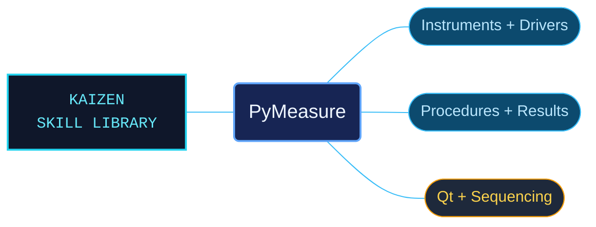

# PyMeasure

PyMeasure references for building scientific measurement workflows from instrument control through data collection and display. The package connects driver APIs, adapters, measurement procedures and Qt interfaces, with instrument material organized by manufacturer and model.

Use when working with PyMeasure scientific measurement, instrument control and experiment automation: Instrument/Channel APIs, instrument drivers, dynamic properties and validators, VISA/serial/Prologix adapters, Procedures, Parameters, Experiments, Workers, Results, plotting, Qt windows or measurement sequencing. Use the bundled model, driver version and interface requirements. Not for raw PyVISA alone, unrelated instrument libraries or general Python.

## What this skill helps with

| Task | Useful reference material |
| --- | --- |
| [Run measurement procedures](references/measurement-procedures/INDEX.md) | Connect procedure execution with results, metadata and the experiment lifecycle. |
| [Build and inspect drivers](references/driver-development/INDEX.md) | Find command properties, channels, validators and protocol-testing guidance. |
| [Select instrument contracts](references/instruments/INDEX.md) | Navigate manufacturer and model references before choosing an operation. |
| [Create graphical measurements](references/graphical-measurements/INDEX.md) | Use Qt windows, plotting and measurement sequencing with the associated display APIs. |

## The work behind the references

Workflow documentation and API contracts are organized separately, with descriptive instrument routes and linked supporting examples. The reference repairs included model-specific organization and an FSL sweep-property correction, preserving units and operation context around the affected material.

## Start here

Start with [SKILL.md](SKILL.md) and follow its context routes.

Match the driver, interface, firmware constraints, physical units and allowed values to the instrument. Consult the [release history](references/release-history/INDEX.md) for version-specific changes. Reference validation does not substitute for checking a measurement on the target hardware.

## Sources and license

Skill reference documentation is interpreted content for use in open source projects. Check against [official documentation sources](https://pymeasure.readthedocs.io/en/latest/) when dealing with defects or issues that may come up from interpreting this skill's references.

Licensed under **AGPL-3.0**; see [LICENSE](LICENSE). Part of the [Agent Kaizen](https://github.com/LevyBytes/agent-kaizen) skill library.
